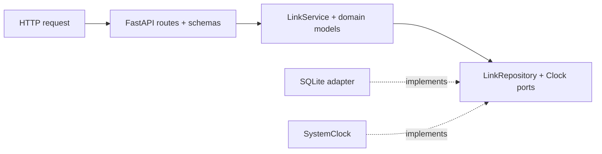

# shortlink

A FastAPI URL shortener used to demonstrate protected PR delivery, shared CI,
strict code quality, security scanning and repository governance.

## Run locally

Install Python 3.12 and [uv](https://docs.astral.sh/uv/getting-started/installation/).

```sh
uv sync --locked
uv run pre-commit install
uv run fastapi dev src/shortlink/main.py
```

Open http://127.0.0.1:8000/docs for interactive API documentation.
Settings use `SHORTLINK_` environment variables; copy `.env.example` to `.env` for
local overrides. The database is created at startup, not when Python imports a module.
Never commit `.env` or the SQLite database.

## API

| Method | Path | Result |
|---|---|---|
| GET | `/health` | liveness JSON |
| POST | `/links` | 201 with code, short URL, metadata and Location |
| GET | `/{code}` | 307 redirect; increments hits once |
| GET | `/links/{code}` | metadata and hit count; does not increment hits |
| DELETE | `/links/{code}` | 204; 404 if absent |

```sh
curl -X POST http://127.0.0.1:8000/links \
  -H 'Content-Type: application/json' \
  -d '{"target_url":"https://example.com/docs","code":"my_docs"}'
```

Codes contain 4-32 ASCII letters, digits, `_` or `-`. Application route names are
reserved. Omit code for a random seven-character base62 code. Generated collisions
retry at most five times. Targets must be HTTP or HTTPS. Optional `expires_at`
must be an aware future timestamp; a link expires at that instant, returning 410.
Duplicate codes return 409, missing links 404, and malformed input 422.
Domain errors use RFC 9457 `application/problem+json`.

This is an unauthenticated educational service. Before a public multi-user launch,
add authorization for management endpoints, rate limits and abuse prevention.
SQLite assumes a persistent disk and one deployment instance; horizontal scaling
needs a shared database. See [the architecture decision](docs/decisions/0001-fastapi-sqlite-uv.md).

## Validate

```sh
uv run ruff format --check .
uv run ruff check .
uv run pyright
uv run pytest --cov --cov-branch --cov-report=xml --cov-report=term-missing
uv run pre-commit run --all-files
```

Coverage must remain at least 90%, including branches. Unit tests use a fixed clock
and fake repository; integration tests use real temporary SQLite databases and
FastAPI TestClient. Concurrent hit updates, persistence, expiry boundaries and
collision retries are covered without sleeps.

## Architecture



Dependencies point inward: domain imports neither FastAPI nor sqlite3. The app
factory wires adapters at startup; hit counts increment atomically in SQL.

## Engineering controls

CI comes from [platform-workflows](https://github.com/Abdel-Abdelaal/platform-workflows),
and settings are declared in [github-governance](https://github.com/Abdel-Abdelaal/github-governance).
The [handbook](https://github.com/Abdel-Abdelaal/.github/tree/main/standards) supplies
shared issue/PR templates and contribution/security policies. CODEOWNERS stays local.

| Milestone | Status |
|---|---|
| Protected PRs and Conventional Commit titles | active |
| Shared community files and AGENTS.md glossary | active |
| Lint, strict types, coverage and runtime dependency audit | active; 46 tests and 100% branch-aware coverage |
| Terraform-managed settings | initial protection/security gates applied; HCP migration and scheduled drift pending |
| Sonar analysis | owner sign-up and verified project settings pending |
| CodeQL, secret scanning and workflow analysis | active |
| Repository conformance | passing; additional required gate awaits governance apply |
| Flash review and weekly audit | advisory reviews verified; corrected weekly audit rollout awaiting verification |
| Baseline propagation, automated fixes and releases | source prepared; maintenance App setup pending |
| Container delivery | v0.1.0 published and both attestations verified |

Each change goes through a PR. Deterministic checks can block merges; AI reviews
remain advisory. Solo repos use zero required approvals because GitHub disallows
self-approval; a team would require reviewers and CODEOWNERS approval.

## Delivery history

- [Foundation PR](https://github.com/Abdel-Abdelaal/shortlink/pull/1)
- [Shared defaults and agent context](https://github.com/Abdel-Abdelaal/shortlink/pull/2)

Managed callers pin release commit SHAs; Dependabot proposes reviewed updates.
The `v1` tag remains available for discovery, while fleet execution is reproducible.

## Container evidence and recovery

The [container workflow](.github/workflows/container.yml) builds the digest-pinned,
non-root runtime, checks HTTP health and SQLite persistence across restart with a
read-only root filesystem, and scans for critical vulnerabilities. Stable releases
publish the tested image with provenance and a CycloneDX SBOM after validation.
See [the operational runbook](docs/container-operations.md) for local smoke checks,
attestation verification, backup/rollback and the hosting boundary.
[v0.1.0](https://github.com/Abdel-Abdelaal/shortlink/releases/tag/v0.1.0) passed
[hosted release validation](https://github.com/Abdel-Abdelaal/shortlink/actions/runs/40148403921);
the runbook records its immutable image digest and commands to verify provenance
and the CycloneDX SBOM. A public application host is still unconfigured.

## Advisory AI maintenance

Same-repository PRs receive an isolated MiMo 2.6 Flash review; fork and Dependabot
PRs skip. Findings are non-blocking summaries and neutral notice annotations.
Weekly audits are designed to maintain one health issue. The initial full audit
failed; corrected tooling passed a local provider integration and awaits hosted
rollout verification. A bounded, tested draft fix PR is possible
only after the automation App is configured; otherwise that step skips explicitly.
No AI check is required for merging, and no AI workflow can merge or approve.
See [the isolation design](https://github.com/Abdel-Abdelaal/platform-workflows/blob/main/docs/ai.md).
